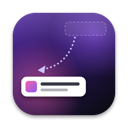
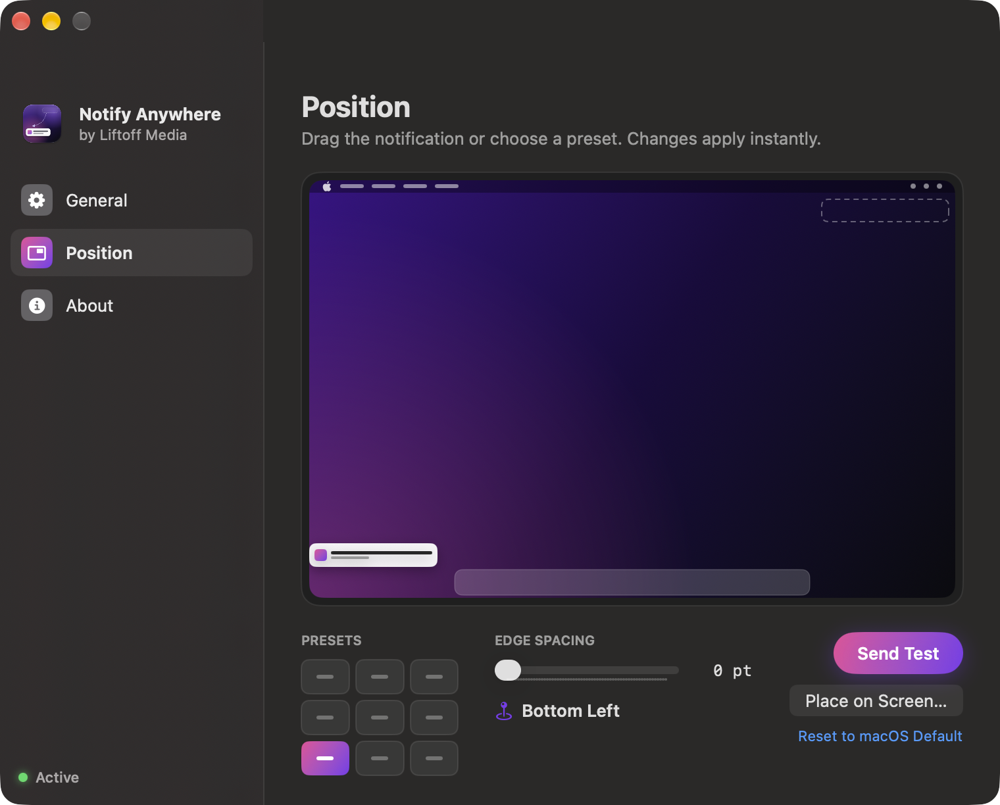
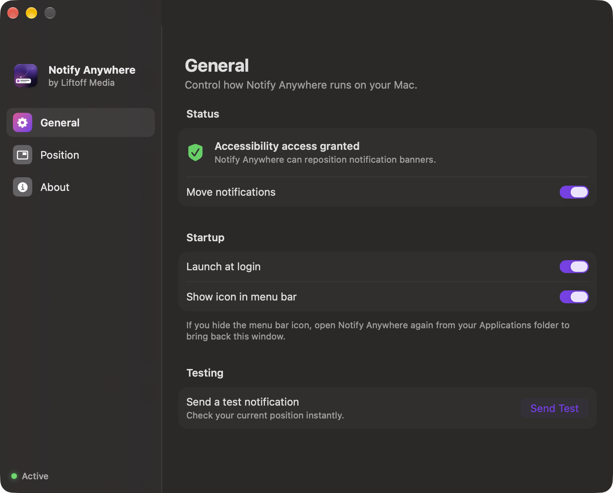
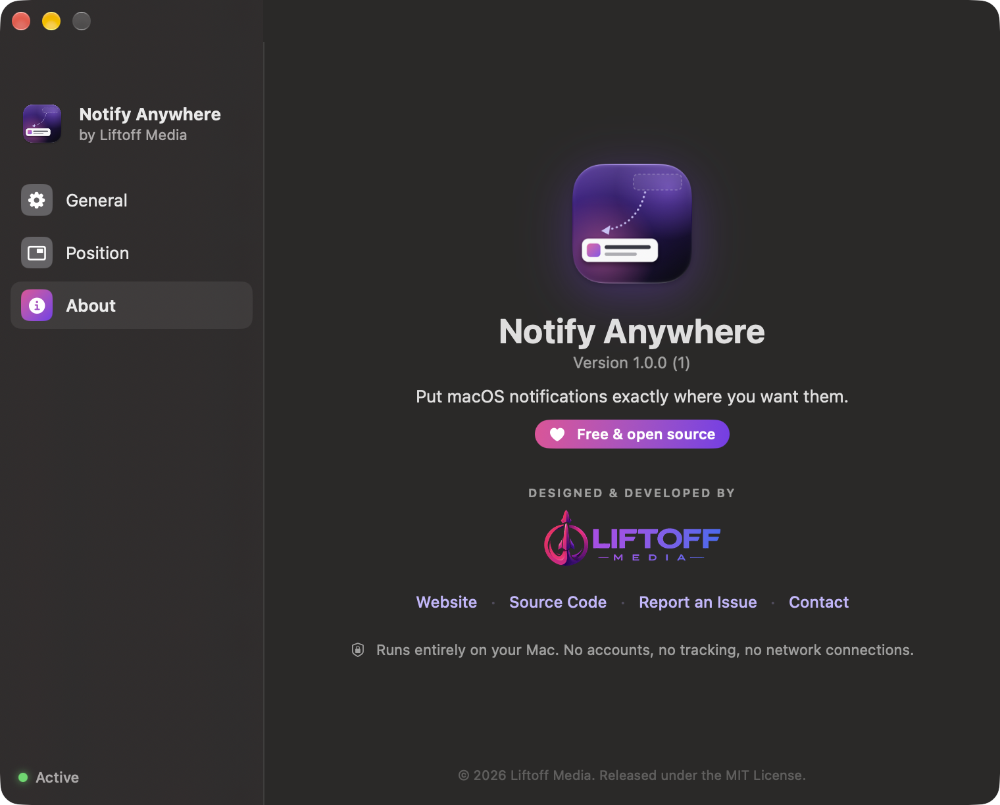

<p align="center">
  
</p>

<h1 align="center">Notify Anywhere</h1>

<p align="center">
  <b>Put macOS notifications exactly where you want them.</b><br>
  Free &amp; open source · Made by <a href="https://liftoffmedia.ro/">Liftoff Media</a>
</p>

---

macOS always shows notification banners in the top-right corner, and there's no setting to change that. Notify Anywhere is a tiny menu bar app that moves them to any corner, edge, the center of the screen, or any spot you drag them to.

<p align="center">
  
</p>

## Features

- **Nine presets**: every corner, every edge, or dead center.
- **Custom placement**: drag a preview notification anywhere; it snaps to edges and centers.
- **Adjustable edge spacing** from 0 to 120 pt.
- **Instant**: banners are repositioned the moment they appear.
- **Doesn't get in the way**: the full Notification Center panel (opened from the clock) stays where macOS puts it.
- **Private**: runs entirely on your Mac. No accounts, no analytics, no network connections.
- Launch at login, hideable menu bar icon, one-click test notification.

<p align="center">
  
  
</p>

## Install

1. Download `NotifyAnywhere-x.y.z.dmg` from the [latest release](https://github.com/viorelepuran/notify-anywhere/releases/latest).
2. Open it and drag **Notify Anywhere** into **Applications**.
3. Launch it and follow the short setup. macOS will ask you to allow **Accessibility** access, which the app needs to move the banner window.

Releases are signed with a Developer ID and notarized by Apple, so they open without security warnings.

**Requirements:** macOS 14 Sonoma or later, on Apple silicon or Intel. So far it has only been tested on macOS 27 (see below).

| macOS | Status |
|---|---|
| 27 | Tested |
| 26 Tahoe | Should work, not tested yet: other open-source banner movers document the same window layout on 26.4–26.6 |
| 14 Sonoma, 15 Sequoia | Should work, not tested yet: built for the per-banner window layout these versions use |

If you run it on a version that isn't marked as tested, a quick note in an [issue](https://github.com/viorelepuran/notify-anywhere/issues) saying whether it works would help a lot.

## How it works

Notification banners are drawn inside windows owned by macOS's Notification Center process: one screen-sized window holding every banner on macOS 26 and later, and a window per banner on earlier versions. Notify Anywhere uses the public Accessibility API to find the banners in those windows and shift the windows so the banners land at your chosen spot. Desktop widgets and the Notification Center panel are left alone. It reads only positions and sizes. Notification content is never stored or sent anywhere.

Because it relies on how macOS lays out that window, a future macOS update could change things. If it stops working, please [open an issue](https://github.com/viorelepuran/notify-anywhere/issues).

**Why not the Mac App Store?** Apple requires App Store apps to be sandboxed, and sandboxed apps can't use the Accessibility API this app depends on.

## Build from source

You need Xcode or the Xcode Command Line Tools.

```bash
git clone https://github.com/viorelepuran/notify-anywhere.git
cd notify-anywhere
./build.sh          # → build/Notify Anywhere.app (universal)
./release.sh        # → build/NotifyAnywhere-<version>.dmg
```

`build.sh` signs with a Developer ID or Apple Development certificate if you have one (so the Accessibility permission survives rebuilds) and falls back to ad-hoc signing otherwise. `release.sh` can also notarize. See the comments at the top of the script.

| Path | What's inside |
|---|---|
| `Sources/NotificationMover.swift` | Watches Notification Center and repositions banners |
| `Sources/Placement.swift` | Placement math (presets, fractions, margins) |
| `Sources/SettingsView.swift`, `OnboardingView.swift`, `ScreenPreview.swift` | SwiftUI interface |
| `Sources/Brand.swift` | Name, links and brand colors |
| `Tools/MakeIcon.swift` | Renders the app icon |

## License

[MIT](LICENSE) © 2026 Liftoff Media. The Liftoff Media name and logo are trademarks of Liftoff Media and aren't covered by the MIT license.

---

<p align="center">
  <a href="https://liftoffmedia.ro/"></a><br>
  <sub>Websites, apps and AI automation · <a href="https://liftoffmedia.ro/">liftoffmedia.ro</a></sub>
</p>
